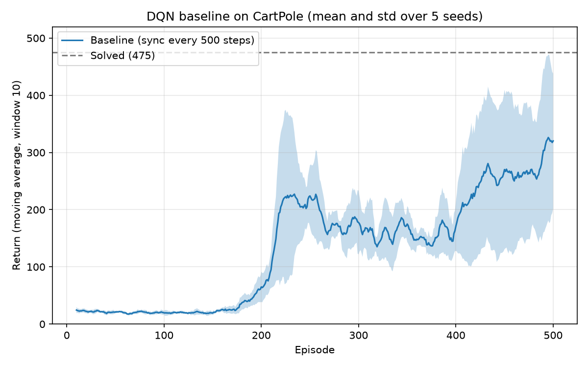
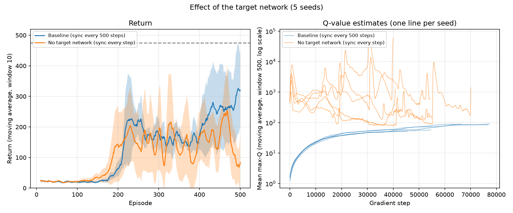

# Lab 2: Deep Q-Networks on CartPole

A Deep Q-Network (DQN) written from scratch for CartPole-v1, using only torch, numpy, gymnasium and matplotlib.

The agent pushes a cart left or right to keep a pole upright, earning +1 per step for up to 500 steps. A small neural network estimates the value of each action, and learns from a replay buffer with the help of a target network.

## Files

| File | Contents |
| --- | --- |
| `dqn.py` | Tasks 1 to 4: replay buffer, Q-network, DQN loss, training loop |
| `experiments.py` | Task 5: baseline and no-target-network experiments |
| `requirements.txt` | Python packages |
| `outputs/report.pdf` | The lab report |
| `outputs/` | Figures and `summary.txt` with the numbers behind them |

## Run

```
pip install -r requirements.txt
python experiments.py
```

This trains 10 agents (2 settings, 5 seeds; 500 episodes each) on the CPU, in about [TODO: run time]. The baseline run with seed 0 is the Task 4 check.

## Experiments

| Setting | Value |
| --- | --- |
| Network | 4 -> [TODO] -> [TODO] -> 2, ReLU |
| Optimiser | Adam, learning rate [TODO], batch [TODO] |
| Replay buffer | [TODO] transitions, uniform sampling |
| Exploration | [TODO: warm-up steps], then epsilon [TODO: start] to [TODO: end] over [TODO] steps |
| Target network | synced every 500 steps (baseline) or every step (no target network) |
| Discount factor | [TODO] |
| Seeds | 0 to 4 |
| Episodes per run | 500 |

## Results

**Task 4:** with seed 0 the best 100-episode average return is **188.5** (needs 400), so the check **fails**. All Q-values stay finite.

| Setting | Best 100-episode average, mean and std over 5 seeds | Final test return |
| --- | --- | --- |
| Baseline | 272.6 ± 85.5 | 157.6 to 500.0 |
| No target network | 229.2 ± 39.7 | 9.0 to 248.4 |



The baseline varies a lot between seeds: the best 100-episode average ranges from 176.0 (seed 1) to 398.7 (seed 4). No seed reached the solved level of 475 within 500 episodes.



Without a target network the Q-values grow to between 6,612.8 and 94,940.0, far above the true maximum of 100, while the baseline stays below 100 (60.8 to 97.0). Three of the five seeds end with a final test return of 9.0. The network is chasing a target that moves with every update.

The full write-up is in [outputs/Report_lab2.pdf](outputs/Report_lab2.pdf).